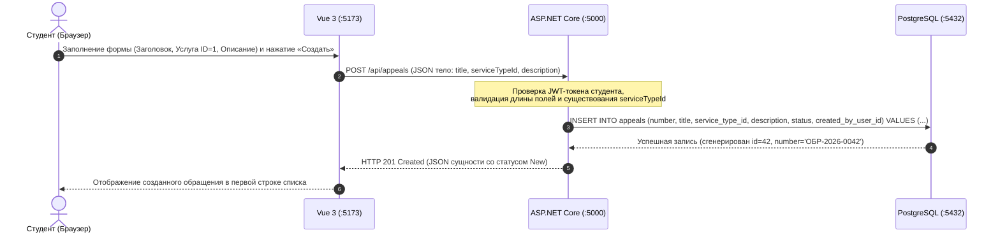

# Архитектура информационной системы

Учебный курс: **РИС и Web** (Б1.В.ДЭ.01.02.02) · КГЭУ · семестр 1 · 2026/2027  
Студент: **Югин Артём** · Группа: **ТРИС-2-23**  
Тема №9: **«Обращения в деканат»** («Электронная приёмная деканата ИЦТЭ КГЭУ»)

---

## 1. Трёхузловая архитектурная схема

Система строится по классической трёхуровневой клиент-серверной архитектуре: клиентское одностраничное веб-приложение (SPA), сервер прикладной логики (Web API) и реляционная система управления базами данных (СУБД).

```text
+-----------------------+            HTTP / JSON            +-----------------------+            SQL (TCP)           +-----------------------+
|     Vue 3 + Vite      | --------------------------------> |     ASP.NET Core      | -----------------------------> |      PostgreSQL       |
|    localhost:5173     | <-------------------------------- |    localhost:5000     | <----------------------------- |    localhost:5432     |
|   (Клиентский SPA)    |       201 Created / 200 OK        |       (Web API)       |        Набор строк / кортежи   |    (База данных)      |
+-----------------------+                                   +-----------------------+                                +-----------------------+
```

> **архитектура web-ИС семестра**

---

## 2. Назначение узлов и сетевые порты

| Узел | Стек / Компонент | Сетевой адрес и порт | Назначение и ответственность |
|------|-------------------|----------------------|------------------------------|
| **Клиент (Frontend)** | Vue 3 + Vite + Pinia | `http://localhost:5173` | Отображение пользовательского интерфейса в браузере, сбор ввода пользователя, клиентская валидация экранных форм, отправка асинхронных HTTP-запросов через Fetch/Axios. |
| **Сервер (Backend)** | ASP.NET Core 8 Web API | `http://localhost:5000` | Реализация REST API, ролевая авторизация (Студент, Замдекана, Сотрудник деканата), валидация данных, исполнение бизнес-правил жизненного цикла обращений (`New` $\to$ `InProgress` $\to$ `Closed`), трансляция запросов в СУБД. |
| **Хранилище данных (Database)** | PostgreSQL 16 | `localhost:5432` | Реляционное хранение персистентных данных (таблицы `appeals`, `service_types`, `users`), обеспечение целостности связей (PK, FK), транзакционная надёжность (ACID). |

---

## 3. Пример взаимодействия узлов (Создание обращения)

На диаграмме ниже показан сквозной цикл выполнения ключевой операции создания нового обращения:



### Пример тела HTTP-запроса от Vue к API:
```http
POST /api/appeals HTTP/1.1
Host: localhost:5000
Content-Type: application/json
Authorization: Bearer <JWT_TOKEN_STUDENT>

{
  "title": "Выдача справки об обучении за 3 семестр",
  "serviceTypeId": 1,
  "description": "Справка необходима по месту работы родителей в пенсионный фонд."
}
```

### Пример ответа сервера ASP.NET Core:
```http
HTTP/1.1 201 Created
Content-Type: application/json
Location: /api/appeals/42

{
  "id": 42,
  "number": "ОБР-2026-0042",
  "title": "Выдача справки об обучении за 3 семестр",
  "serviceTypeId": 1,
  "description": "Справка необходима по месту работы родителей в пенсионный фонд.",
  "status": "New",
  "createdByUserId": 15,
  "assigneeUserId": null,
  "createdAt": "2026-10-12T12:30:00Z",
  "updatedAt": "2026-10-12T12:30:00Z"
}
```

---

## 4. Почему браузер НЕ обращается к PostgreSQL напрямую

Прямая стрелка `Vue (:5173) ──► PostgreSQL (:5432)` **категорически отсутствует** на архитектурной схеме по следующим фундаментальным причинам безопасности и архитектуры:

1. **Компрометация учётных данных СУБД:**  
   Браузер пользователя — это недоверенная клиентская среда. Любой код и конфигурация JavaScript, исполняемые в браузере, могут быть исследованы через DevTools. Прямое соединение потребовало бы зашивать пароли и реквизиты доступа к БД в клиентское приложение, что даёт любому пользователю полный бесконтрольный доступ ко всей базе данных.
2. **Невозможность обеспечения ролевой бизнес-логики на уровне СУБД:**  
   Только сервер приложений (ASP.NET Core) знает правила предметной области: например, что студент не может перевести обращение в статус `InProgress`, а сотрудник деканата может изменять статус только тех обращений, где он назначен исполнителем.
3. **Единый источник правды (Single Source of Truth):**  
   Сервер ASP.NET Core является единой точкой входа, централизованно проверяющей валидность данных, ведущей логирование действий и обеспечивающей согласованность жизненного цикла записей для всех параллельных клиентов.
4. **Сетевая изоляция контура данных:**  
   СУБД PostgreSQL разворачивается во внутреннем защищённом сетевом контуре (private subnet / внутри Docker-сети), недоступном из внешней публичной сети интернет, в то время как наружу выставляются только безопасные HTTP-порты прикладного Web API.
