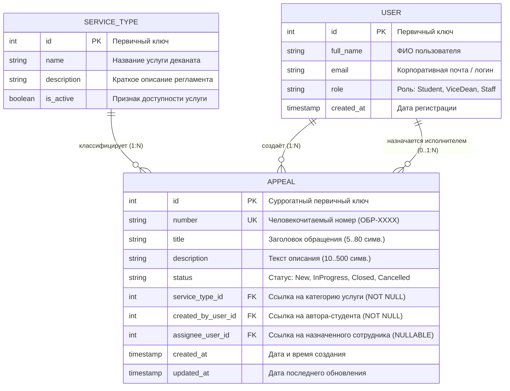

# Модель данных и ER-диаграмма

Учебный курс: **РИС и Web** (Б1.В.ДЭ.01.02.02) · КГЭУ · семестр 1 · 2026/2027  
Студент: **Югин Артём** · Группа: **ТРИС-2-23**  
Тема №9: **«Обращения в деканат»** («Электронная приёмная деканата ИЦТЭ КГЭУ»)

---

## 1. Словарь терминов проекта

Для сохранения единообразия в коде интерфейса Vue 3, серверных моделях C# (ASP.NET Core) и схеме базы данных PostgreSQL зафиксированы следующие соответствия:

| Термин курса (лекция) | Термин предметной области темы №9 | Имя сущности в C# | Таблица в PostgreSQL | Поле внешнего ключа |
|-----------------------|-----------------------------------|-------------------|----------------------|---------------------|
| `Ticket` (главный объект) | Обращение студента | `Appeal` | `appeals` | — |
| `Site` (справочник) | Категория услуги деканата | `ServiceType` | `service_types` | `service_type_id` / `ServiceTypeId` |
| `User` (пользователь) | Пользователь (студент / сотрудник) | `User` | `users` | `created_by_user_id`, `assignee_user_id` |

---

## 2. Диаграмма сущностей и связей (ER-диаграмма)

---

## 3. Спецификация связей между сущностями

1. **`SERVICE_TYPE` $\longrightarrow$ `APPEAL` (Один-ко-многим, 1 : N):**  
   Один тип академической услуги из справочника может быть указан во множестве обращений студентов. Каждое обращение обязательно ссылается ровно на одну существующую категорию услуги (`service_type_id NOT NULL`).
2. **`USER` (Автор) $\longrightarrow$ `APPEAL` (Один-ко-многим, 1 : N):**  
   Один студент может за время обучения создать множество обращений в деканат. Каждое обращение строго привязано к своему автору (`created_by_user_id NOT NULL`).
3. **`USER` (Исполнитель) $\longrightarrow$ `APPEAL` (Ноль/один-ко-многим, 0..1 : N):**  
   На одно обращение может быть назначен ноль или один ответственный сотрудник деканата. При создании нового обращения исполнитель **отсутствует** (`assignee_user_id IS NULL`). Заместитель декана может назначить конкретного сотрудника отдельным действием, при этом один сотрудник может одновременно вести несколько назначенных ему обращений.

---

## 4. Разделение понятий: Машинный `id` и Человеческий номер `number`

В системе строго разделены два идентификатора:
* **`id` (Primary Key):**  
  Суррогатный целочисленный первичный ключ базы данных (`int`, автоинкремент `IDENTITY` в PostgreSQL). Используется исключительно компьютером: для организации индексов, связей внешних ключей (FK) и адресации ресурсов в REST API (например, `PATCH /api/appeals/42/status`). Пользователь не обязан его знать и диктовать.
* **`number` (Unique Business Key):**  
  Человекочитаемый уникальный регистрационный номер документа по номенклатуре вуза (строка вида `ОБР-2026-0042`). Генерируется сервером при создании обращения, отображается в веб-интерфейсе и служит для устного общения студента с сотрудниками деканата при поиске заявления.

---

## 5. Проверка третьей нормальной формы (3НФ)

Реляционная модель данных спроектирована в полном соответствии с требованиями **3-й нормальной формы (3НФ)**:

> **Обоснование 3НФ:**  
> Название услуги деканата (например, «Выдача справки об обучении») хранится в отдельной сущности-справочнике `ServiceType` ровно один раз. Таблица обращений `Appeal` содержит исключительно числовой внешний ключ `service_type_id`. При переименовании или уточнении регламента оказания услуги изменяется одна-единственная строка в таблице `service_types`. Текстовое название услуги не дублируется в записях обращений студентов, что исключает избыточность хранения и аномалии обновления данных. Каждый неключевой атрибут обращения непосредственно зависит от первичного ключа `id`, нет транзитивных зависимостей.
