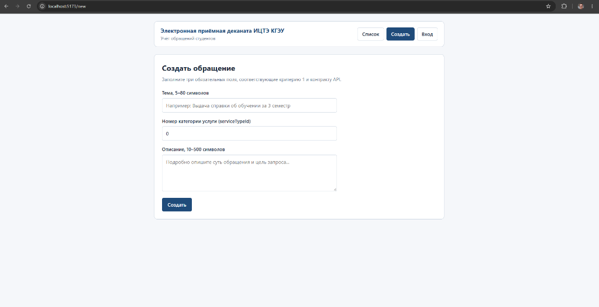

# Отчёт по лабораторной работе №4
## Тема: «Vue 3: компоненты и маршруты»

- **Дисциплина:** РИС и Web (Б1.В.ДЭ.01.02.02)
- **Вуз:** Казанский государственный энергетический университет (КГЭУ)
- **Институт:** Институт цифровых технологий и экономики (ИЦТЭ)
- **Студент:** Югин Артем
- **Группа:** ТРИС-2-23
- **Тема №9:** «Обращения в деканат» («Электронная приёмная деканата ИЦТЭ КГЭУ»)
- **Стек клиентской части:** Vue 3 + Vite + `vue-router` (JavaScript, без Pinia и TypeScript)

---

## 1. Цель работы
Декомпозировать каркас из ЛР3 на отдельные компоненты (`AppHeader.vue`, `AppealTable.vue`) и страницы (`AppealList.vue`, `AppealNew.vue`, `Login.vue`), подключить `vue-router` для маршрутов `/`, `/new`, `/login` и вынести единый источник данных в модуль `appealsStore.js`.

---

## 2. Дерево `frontend/src/`

```text
frontend/src/
├── main.js                   ← подключение router через app.use(router)
├── style.css                 ← базовые стили оформления
├── App.vue                   ← корневой каркас: AppHeader снаружи, router-view внутри
├── router.js                 ← маршруты /, /new, /login (createWebHistory)
├── appealsStore.js           ← единственный общий массив items (без Pinia)
├── components/
│   ├── AppHeader.vue         ← меню навигации на <router-link>
│   └── AppealTable.vue       ← таблица обращений (принимает :items через defineProps)
└── pages/
    ├── AppealList.vue        ← страница списка (/)
    ├── AppealNew.vue         ← страница создания (/new)
    └── Login.vue             ← страница входа (/login)
```

---

## 3. Схема компоновки: `AppHeader` снаружи, `router-view` внутри

```text
┌──────────────────────────────────────────────────────────┐
│  App.vue                                                 │
│  ┌────────────────────────────────────────────────────┐  │
│  │  <AppHeader />  (router-link: /   /new   /login)   │  │
│  └────────────────────────────────────────────────────┘  │
│  ┌────────────────────────────────────────────────────┐  │
│  │  <router-view />                                   │  │
│  │     Подставляется одна из страниц:                 │  │
│  │     • AppealList   — адрес /                       │  │
│  │     • AppealNew    — адрес /new                    │  │
│  │     • Login        — адрес /login                  │  │
│  └────────────────────────────────────────────────────┘  │
└──────────────────────────────────────────────────────────┘
```

**Ключевой принцип данных:** таблица получает массив через props, источник — `appealsStore.js`. Компонент `AppealTable.vue` не создаёт локальную копию списка и рисует данные, переданные сверху из `AppealList.vue`.

---

## 4. Скриншот адресной строки `/new`



---

## 5. Чеклист перед сдачей

| Проверка | Статус |
|----------|--------|
| Установлен `vue-router` (`package.json` и `package-lock.json` обновлены) | да |
| Ручной ввод `/`, `/new`, `/login` открывает соответствующие экраны | да |
| Меню использует `<router-link>`, старые кнопки с `v-if` удалены | да |
| `AppHeader` находится снаружи `<router-view />` и виден на всех страницах | да |
| Таблица `AppealTable.vue` объявляет обязательный prop `items` без локальной копии | да |
| Единственный массив находится в `src/appealsStore.js` (без Pinia) | да |

---

## 6. Ответы на контрольные вопросы защиты

1. **Чем `/new` отличается от `POST /api/appeals`?**  
   *Ответ:* `/new` — это клиентский маршрут внутри `vue-router` (`http://localhost:5173/new`), который отвечает только за отображение в браузере компонента страницы с формой `AppealNew.vue`. `POST /api/appeals` — это серверный HTTP-запрос к ASP.NET Core API (`http://localhost:5000/api/appeals`), который будет отправляться при нажатии кнопки «Создать» для сохранения новой записи в PostgreSQL.

2. **Кто владеет массивом записей?**  
   *Ответ:* Единым владельцем реактивного массива `items` выступает общий модуль `src/appealsStore.js`. Страницы и компоненты лишь импортируют ссылку на этот массив, чтобы список и форма работали с одними и теми же данными в рамках сессии.

3. **Зачем таблице `props`?**  
   *Ответ:* Использование `defineProps({ items: { type: Array, required: true } })` делает `AppealTable.vue` переиспользуемым презентационным (dumb) компонентом: таблица просто отображает переданные сверху данные и не привязана жёстко к конкретному массиву. Если она создаст собственную копию, изменения в общем хранилище перестанут отображаться.

4. **Почему шапка должна быть снаружи `<router-view />`?**  
   *Ответ:* Чтобы меню навигации оставалось общим для всего приложения и не дублировалось в трёх файлах страниц. При переходе между `/`, `/new` и `/login` перерисовывается только внутренняя область `<router-view />`, а `AppHeader` всегда остаётся на экране.
