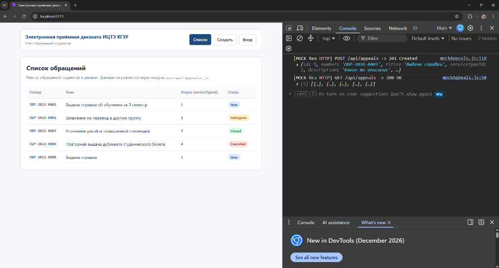
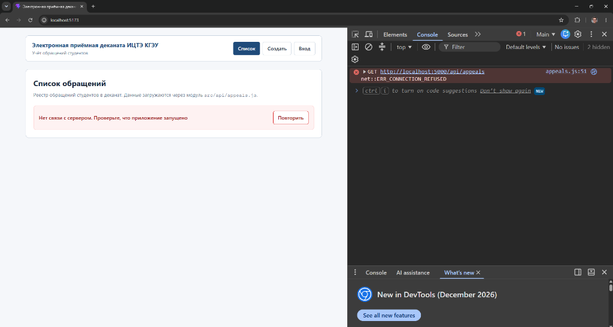

# Отчёт по лабораторной работе №6
## Тема: «Vue 3: клиент API и mock»

- **Дисциплина:** РИС и Web (Б1.В.ДЭ.01.02.02)
- **Вуз:** Казанский государственный энергетический университет (КГЭУ)
- **Институт:** Институт цифровых технологий и экономики (ИЦТЭ)
- **Студент:** Югин Артем
- **Группа:** ТРИС-2-23
- **Тема №9:** «Обращения в деканат» («Электронная приёмная деканата ИЦТЭ КГЭУ»)
- **Стек клиентской части:** Vue 3 + Vite + `vue-router` + `fetch` / mock (JavaScript)

---

## 1. Цель работы
Инкапсулировать работу с данными в клиентский API-модуль (`src/api/appeals.js`) с переключением между учебным mock-модулем (`src/api/mockAppeals.js`) и реальным `fetch` на `VITE_API_BASE_URL=http://localhost:5000`, реализовать 4 взаимоисключающих состояния списка (`loading | empty | data | error`), защиту от двойной отправки и обработку трёх типов отказов (`400`, `500`, отсутствие связи).

---

## 2. Реализованная архитектура клиента API

1. **Конфигурация окружения:**
   * Локальный файл `frontend/.env` (`VITE_API_BASE_URL=http://localhost:5000`) исключён из Git через `.gitignore`.
   * В репозитории зафиксирован шаблон `frontend/.env.example`.

2. **API-модуль (`frontend/src/api/appeals.js`):**
   * Экспортирует две функции контракта: `getAppeals()` и `createAppeal(body)` и переключатель `USE_MOCK`.
   * Страницы `AppealList.vue` и `AppealNew.vue` не знают URL и не импортируют mock напрямую.
   * Ветка `!response.ok` различает коды `400` и `500`; сетевые ошибки `fetch` в блоке `catch` не подменяются кодом `500`.

3. **Mock-модуль (`frontend/src/api/mockAppeals.js`):**
   * Эмулирует сетевую задержку ~500 мс, возвращает `200` (список), `201` (созданное обращение с серверными `id` и `number` вида `ОБР-2026-0005` и статусом `New`), `400` (ошибка валидации) и учебный флаг `mockConfig.force500` (`500`).

4. **Состояния UI и защита от двойного клика:**
   * `AppealList.vue` использует взаимоисключающее состояние `screen: 'loading' | 'empty' | 'data' | 'error'` и вызывает `getAppeals()` в `onMounted`.
   * `AppealNew.vue` устанавливает `isSubmitting = true` до вызова `createAppeal`, блокирует кнопку («Создаём…» / `:disabled="isSubmitting"`), снимает флаг в `finally` и при ошибке оставляет поля заполненными для исправления.

---

## 3. Чеклист трёх отказов

| Отказ | Как воспроизвести | Что в Network / коде | Текст человеку | Проверено |
|-------|-------------------|----------------------|----------------|-----------|
| **400** | Передать `title` короче 5 символов или несуществующий `serviceTypeId` (например, `150`) | Статус `400`, ветка `!response.ok` (`ApiError`, `status: 400`) | «Проверьте поля» | да |
| **500** | Включить `mockConfig.force500 = true` в `mockAppeals.js` | Статус `500`, ветка `!response.ok` (`ApiError`, `status: 500`) | «Сервер не смог обработать запрос» | да |
| **Нет связи** | Переключить `USE_MOCK = false` в `appeals.js` при выключенном C#-сервере на порту `5000` | Неуспешный запрос к `localhost:5000` в Network (`ERR_CONNECTION_REFUSED`), срабатывает ветка `catch` (`isNetworkError: true`) | «Нет связи с сервером. Проверьте, что приложение запущено» | да |

---

## 4. Проверка Network / mock без HTTP

- При `USE_MOCK = true` обращение идёт через JavaScript-модуль `mockAppeals.js` (режим **«mock без HTTP»**, пауза 500 мс, в ответе возвращаются сгенерированные сервером `id` и `number`).
- При переключении `USE_MOCK = false` без запущенного сервера ASP.NET Core во вкладке DevTools → **Network → Fetch/XHR** отображается попытка запроса к `http://localhost:5000/api/appeals` и переход в ветку `catch` («Нет связи с сервером»).

### Успешное создание обращения (mock без HTTP)

### Отказ «Нет связи с сервером» (`USE_MOCK = false`, порт `5000`)

---

## 5. Чеклист перед сдачей

| Проверка | Статус |
|----------|--------|
| Созданы `frontend/.env.example` (`http://localhost:5000`) и локальный `frontend/.env` | да |
| `.env` исключён из Git (проверено `git check-ignore`), `.env.example` отслеживается | да |
| Реализованы `src/api/appeals.js` и `src/api/mockAppeals.js` с `getAppeals` и `createAppeal` | да |
| Реальная ветка использует встроенный `fetch` (без axios) | да |
| Список различает 4 состояния (`loading`, `empty`, `data`, `error`) | да |
| Кнопка создания блокируется на время запроса (`disabled`), двойной клик создаёт одну запись | да |
| `id` и `number` берутся из ответа `createAppeal`, после отказа поля сохраняются | да |
| Воспроизведены `400`, `500` и отсутствие связи с разными сообщениями | да |

---

## 6. Ответы на контрольные вопросы защиты

1. **Почему `400` не попадает в `catch`?**  
   *Ответ:* Для `fetch` ошибкой (исключением для `catch`) является только ситуация, когда HTTP-ответ вообще не получен (нет сети, сервер не запущен, неверный порт/хост). Если сервер ответил кодом `400 Bad Request` или `500`, HTTP-обмен состоялся, поэтому `fetch` успешно разрешает `Promise`, а проверять неуспешный HTTP-статус нужно вручную через `!response.ok` и `response.status`.

2. **Чем `500` отличается от отсутствия сети?**  
   *Ответ:* При `500` сервер ASP.NET Core запущен, принял запрос и сам вернул HTTP-ответ с кодом ошибки (`!response.ok`, `status === 500`). При отсутствии сети ответа нет вовсе — срабатывает блок `catch`, и подменять такой сбой сообщением «Ошибка 500» нельзя.

3. **Откуда берутся `id` и `number`?**  
   *Ответ:* Они формируются на стороне сервера (в текущей работе — в `mockAppeals.js`) при создании записи и возвращаются в JSON-ответе со статусом `201 Created`. Клиент не вычисляет их сам.

4. **Зачем блокировать кнопку во время POST?**  
   *Ответ:* Запрос к серверу выполняется асинхронно (в нашем случае с паузой ~500 мс). Если не поставить флаг `isSubmitting` и `:disabled="isSubmitting"`, двойной клик по кнопке отправит два параллельных `POST`-запроса и создаст в базе данных два дубликата обращения.
