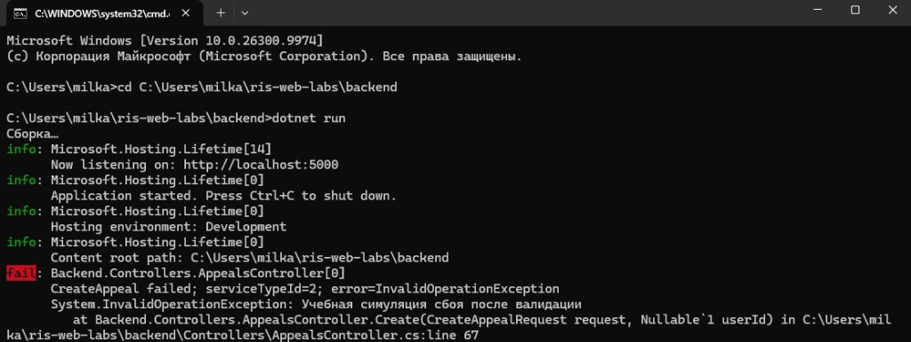

# Отчёт по лабораторной работе №8
## Тема: «REST: создание, чтение, назначение и статус»

- **Дисциплина:** РИС и Web (Б1.В.ДЭ.01.02.02)
- **Вуз:** Казанский государственный энергетический университет (КГЭУ)
- **Институт:** Институт цифровых технологий и экономики (ИЦТЭ)
- **Студент:** Югин Артем
- **Группа:** ТРИС-2-23
- **Тема №9:** «Обращения в деканат» («Электронная приёмная деканата ИЦТЭ КГЭУ»)
- **Стек серверной части:** .NET 8 + ASP.NET Core Web API (данные в памяти)

---

## 1. Цель работы
Реализовать REST-маршруты главного ресурса `/api/appeals` в слоистой архитектуре (`Controllers / Dtos / Models / Services`), обеспечить валидацию входного контракта и правила жизненного цикла (`200`, `201`, `400`, `404`, `409`), безопасное логирование неожиданного сбоя `500` без передачи stack trace клиенту, а также экспортировать коллекцию запросов в `/docs/api-collection/`.

---

## 2. Реализованные эндпоинты и контракты

| Метод и путь | Назначение | Успех | Коды отказов |
|--------------|------------|:-----:|--------------|
| `GET /api/appeals` | Список обращений (поддержка `?status=&serviceTypeId=`, пустой список — `[]`) | `200` | — |
| `GET /api/appeals/{id}` | Получение одной карточки обращения | `200` | `404` |
| `POST /api/appeals` | Создание обращения (`id`, `number`, `status: "New"`, `assigneeUserId: null` задаёт сервер) | `201` | `400`, `500` |
| `PATCH /api/appeals/{id}/assignee` | Отдельное назначение исполнителя (`assigneeUserId`) без смены статуса | `200` | `400`, `404`, `409` |
| `PATCH /api/appeals/{id}/status` | Смена статуса (`New`, `InProgress`, `Closed`, `Cancelled`) с проверкой `X-User-Id` | `200` | `400`, `404`, `409` |

- Метод `DELETE` в API отсутствует.
- Во входном DTO `CreateAppealRequest` нет полей `id`, `number`, `status` и `assigneeUserId`, поэтому клиент не может подменить статус при создании.
- Идентификация текущего пользователя выполняется через заголовок `X-User-Id` (по умолчанию при создании — `1`).

---

## 3. Доказательство безопасной обработки `500` и серверного лога

В среде `Development` при передаче заголовка `X-Simulate-Error: true` на `POST /api/appeals` после валидации эмулируется `InvalidOperationException`.

**Строка в логе сервера (`dotnet run`):**
```text
fail: Backend.Controllers.AppealsController[0]
      CreateAppeal failed; serviceTypeId=2; error=InvalidOperationException
```



**Ответ клиенту (`500 Internal Server Error`, `ProblemDetails` без stack trace и путей на диске):**
```json
{
  "type": "https://tools.ietf.org/html/rfc9110#section-15.6.1",
  "title": "Не удалось обработать запрос",
  "status": 500,
  "traceId": "00-c185e3d0d3b3bc8e7956b4043c4f3f6-0e1b8d076605f76a-00"
}
```

---

## 4. Результаты проверки сценариев

| Сценарий | Запрос | Ожидаемый код | Фактический результат |
|----------|--------|:-------------:|:---------------------:|
| Пустой список после запуска | `GET /api/appeals` | `200` (`[]`) | `200 []` |
| Успешное создание | `POST /api/appeals` | `201` | `201`, `id: 1`, `number: "ОБР-2026-0001"`, `status: "New"` |
| Короткий `title` (`"Абв"`) | `POST /api/appeals` | `400` | `400` (`ValidationProblemDetails`) |
| Несуществующий `id` (`999999`) | `GET /api/appeals/999999` | `404` | `404` (`ProblemDetails`) |
| Перевод в `InProgress` без исполнителя | `PATCH /api/appeals/1/status` | `409` | `409` («пока не назначен исполнитель») |
| Назначение исполнителя (`assigneeUserId: 2`) | `PATCH /api/appeals/1/assignee` | `200` | `200`, `assigneeUserId: 2`, `status: "New"` |
| Перевод в работу чужим пользователем (`X-User-Id: 99`) | `PATCH /api/appeals/1/status` | `409` | `409` |
| Перевод в работу и закрытие назначенным (`X-User-Id: 2`) | `PATCH /api/appeals/1/status` | `200` | `200` (`InProgress` $\to$ `Closed`) |
| Неожиданный сбой (`X-Simulate-Error: true`) | `POST /api/appeals` | `500` | `500` (`ProblemDetails` без стека) + строка лога |

---

## 5. Чеклист перед сдачей

| Проверка | Статус |
|----------|--------|
| `POST /api/appeals` создаёт запись и возвращает `201` с `id`, `number`, `status: "New"` | да |
| Короткий `title` (или пробелы) возвращает `400` | да |
| Несуществующий `id` возвращает `404` | да |
| Нарушение правила процесса (в работу без исполнителя / чужой пользователь) возвращает `409` | да |
| Назначение и статус — два раздельных `PATCH`; `DELETE` отсутствует | да |
| Коллекция запросов с `201`, `400`, `404`, `409`, `500` сохранена в `docs/api-collection/appeals.postman_collection.json` | да |
| В `README.md` указаны `http://localhost:5000`, импорт коллекции и хранение данных в памяти | да |
| Клиент не получает stack trace при `500`; на сервере пишется понятная строка лога | да |

---

## 6. Ответы на контрольные вопросы защиты

1. **Почему назначение и статус — два PATCH?**  
   *Ответ:* Это два независимых действия с разными ролями и правилами: назначение исполнителя меняет `assigneeUserId` (при этом статус остаётся `New`), а смена статуса переводит жизненный цикл (`InProgress`, `Closed`, `Cancelled`) с проверкой назначенного сотрудника. Разделение не позволяет случайно перезаписать чужое поле в одном запросе.

2. **Чем `400` отличается от `409`?**  
   *Ответ:* `400 Bad Request` означает синтаксическую или форматную ошибку входных данных (короткая тема, отрицательный `serviceTypeId`, некорректный статус). `409 Conflict` означает, что сами данные валидны, но действие противоречит текущему состоянию бизнес-процесса (например, попытка взять в работу неназначенное или чужое обращение).

3. **Почему пустой список — `200`, а не `404`?**  
   *Ответ:* Ресурс коллекции `/api/appeals` существует и успешно найден, просто на данный момент в нём ноль записей — это штатный пустой массив `[]` с кодом `200 OK`. Код `404` возвращается только при запросе конкретного отсутствующего ресурса по идентификатору (`/api/appeals/999999`).

4. **Что видит клиент и разработчик при неожиданном сбое?**  
   *Ответ:* Клиент получает краткий безопасный ответ `ProblemDetails` с кодом `500` и заголовком «Не удалось обработать запрос» без stack trace, путей к файлам и секретов. Разработчик видит в серверном логе структурированную запись с названием операции, ключевым параметром (`serviceTypeId`) и типом исключения.
